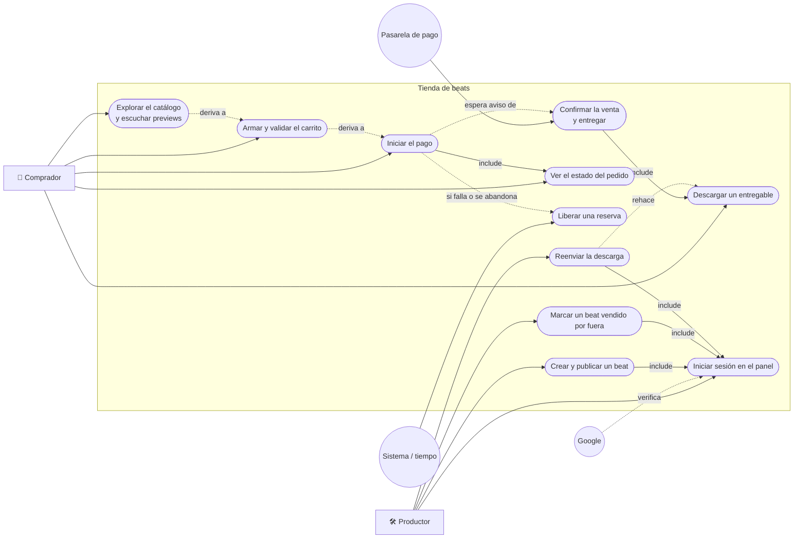

# Casos de Uso — Tienda de beats exclusivos

Fecha: 2026-11-26
Estado: **todos Propuestos — nada está construido.** Diseño en [`tienda-beats.md`](./tienda-beats.md),
decisión en ADR-17 ([`architecture.md`](./architecture.md)), requisitos en
[`rf-rnf-catalogo.md`](./rf-rnf-catalogo.md) §2.3 y §2.4. Mismo formato y mismas convenciones que
[`casos-uso.md`](./casos-uso.md).

Cada caso de uso tiene **un diagrama de secuencia** en `tienda-beats.md` §4: la ficha dice *qué*
quiere lograr el actor y qué reglas aplican; el diagrama dice *cómo* lo resuelve el sistema.

## Actores

| Actor | Quién es |
|---|---|
| **Comprador** | Artista o manager que quiere comprar un beat. Sin cuenta: se identifica con nombre y email al pagar. |
| **Productor** | ALIENSKILEZ. Usa el panel; es el único usuario con sesión. |
| **Pasarela de pago** | Mercado Pago o Flow (pendiente, ALS-048). Cobra la tarjeta y avisa por webhook. |
| **Google** | Verifica la identidad del Productor al iniciar sesión. |
| **Sistema** | Actor del tiempo: la expiración de una reserva ocurre sin que nadie haga nada. |

## Diagrama

## Trazabilidad

| Caso de uso | Diagrama | RF | Ticket | Estado |
|---|---|---|---|---|
| CU-CAT-001 | 4.1 | RF-CAT-001 a 006 | ALS-051, ALS-052 | Propuesto |
| CU-CAR-001 | 4.2 | RF-CAR-001 a 004 | ALS-051, ALS-053 | Propuesto |
| CU-PAG-001 | 4.3 | RF-PAG-001, 002, 004; RF-CAR-004 | ALS-050, ALS-054 | Propuesto |
| CU-PAG-002 | 4.4 | RF-PAG-005, 006, 009; RF-ENT-001, 003, 004 | ALS-055, ALS-057 | Propuesto |
| CU-PAG-003 | 4.5 | RF-PAG-007 | ALS-056 | Propuesto |
| CU-PAG-004 | 4.6 | RF-PAG-003, 008 | ALS-050, ALS-055 | Propuesto |
| CU-ENT-001 | 4.11 | RF-ENT-002 | ALS-057 | Propuesto |
| CU-ADM-001 | 4.7 | RF-ADM-001 | ALS-058 | Propuesto |
| CU-ADM-002 | 4.8 | RF-ADM-002 a 004 | ALS-059 | Propuesto |
| CU-ADM-003 | 4.9 | RF-ADM-005 | ALS-060 | Propuesto |
| CU-ADM-004 | 4.10 | RF-ADM-006 | ALS-060 | Propuesto |

**Historias de usuario:** todavía no existen para la tienda (`historias-usuario.md` no las incluye).
Las fichas de abajo dejan la columna HU en blanco a propósito en vez de inventar IDs.

---

# CU-CAT-001 — Explorar el catálogo y escuchar previews

- Actor primario: Comprador · Secundarios: ninguno
- **Objetivo:** decidir si un beat le sirve, escuchándolo antes de comprar.
- Disparador: el visitante abre la página del catálogo.
- Precondiciones: ninguna. No hay sesión.
- Postcondición éxito: el comprador oyó la preview y conoce BPM, tonalidad y precio.
- Postcondición fallo: el catálogo se muestra vacío o con aviso; la landing no se ve afectada.
- Prioridad: **Alta** · Frecuencia: alta
- RF: RF-CAT-001 a 006 · Diagrama: 4.1 · Estado: **Propuesto**

### Flujo principal
1. El comprador abre el catálogo (enlazado desde el navbar de la landing).
2. El sistema muestra los beats disponibles con título, BPM, tonalidad, género y precio en CLP.
3. Cada portada se pide a la API a medida que entra en pantalla.
4. El comprador filtra por género, BPM o tonalidad; el filtrado ocurre en el navegador.
5. El comprador presiona play en un beat.
6. El sistema pausa cualquier otra preview que estuviera sonando y descarga la preview recién ahora.
7. El comprador escucha, adelanta y puede seguir con CU-CAR-001.

### Flujos alternos
- **A1: beat reservado por otro comprador.** (Paso 2) Se muestra "No disponible por ahora", con el
  botón deshabilitado y el estado anunciado a lectores de pantalla.
- **A2: el productor decide mostrar los vendidos.** (Paso 2) Aparecen como "Vendido", sin botón de
  agregar. *[Pendiente de decisión del Productor, ALS-048.]*

### Flujos de excepción
- **E1: la preview o la portada devuelve 404.** (Pasos 3 y 6) El beat se vendió o se despublicó
  mientras el comprador navegaba. Se muestra el beat como no disponible, nunca un reproductor roto.
- **E2: la API no responde.** (Paso 2) Mensaje de error con opción de reintentar; no se muestra una
  lista vacía como si no hubiera beats.
- **E3: el audio no carga.** (Paso 6) El reproductor muestra el error en ese beat; el resto del
  catálogo sigue usable.

### Reglas de negocio
- RN-01: solo se listan beats `disponible` o `reservado`; nunca `borrador`.
- RN-02: el audio no se descarga hasta que el comprador presiona play (`preload="none"`).
- RN-03: solo una preview suena a la vez.
- RN-04: el navegador nunca habla con el storage: portadas y previews se piden a la API
  (`tienda-beats.md` §2.1).
- RN-05: el catálogo no descarga JS en la landing, ni la landing en el catálogo (RNF-RND-003).

---

# CU-CAR-001 — Armar y validar el carrito

- Actor primario: Comprador · Secundarios: ninguno
- **Objetivo:** juntar uno o más beats y confirmar que siguen disponibles antes de pagar.
- Disparador: el comprador presiona "agregar" en un beat, o abre el carrito.
- Precondiciones: el beat está `disponible`.
- Postcondición éxito: el carrito contiene solo beats disponibles y muestra el total real.
- Postcondición fallo: lo que ya no está disponible se quita con aviso; lo demás queda intacto.
- Prioridad: **Alta** · Frecuencia: alta
- RF: RF-CAR-001 a 004 · Diagrama: 4.2 · Estado: **Propuesto**

### Flujo principal
1. El comprador agrega un beat; el sistema guarda su id en el carrito local.
2. El comprador abre el carrito.
3. El sistema valida los ids contra la API.
4. La API responde qué beats siguen disponibles y el total calculado en el servidor.
5. El sistema muestra el carrito con el total y habilita "Pagar". El comprador continúa con
   CU-PAG-001.

### Flujos alternos
- **A1: recarga la página.** (Entre 1 y 2) El carrito sobrevive: se lee del almacenamiento local y
  se revalida al abrirlo.
- **A2: intenta agregar el mismo beat otra vez.** (Paso 1) No se duplica; no hay cantidades.
- **A3: quita un beat.** (Paso 2) Se actualiza el total desde la API.

### Flujos de excepción
- **E1: un beat se vendió o se reservó mientras estaba en el carrito.** (Paso 4) Se quita con un
  aviso que dice cuál. Si era el único, el carrito queda vacío.
- **E2: la API no responde.** (Paso 3) "Pagar" queda deshabilitado; el carrito no se vacía.

### Reglas de negocio
- RN-01: un beat entra al carrito una sola vez; la exclusividad hace que no existan cantidades.
- RN-02: **el total lo calcula siempre el servidor.** Modificar un precio en las herramientas del
  navegador no cambia lo que se cobra.
- RN-03: el carrito local guarda solo ids, nunca precios ni estados.
- RN-04: el estado del carrito se lee con `useSyncExternalStore`, sin store global (ADR-9).

---

# CU-PAG-001 — Iniciar el pago

- Actor primario: Comprador · Secundarios: Pasarela de pago
- **Objetivo:** reservar los beats y llegar a la página de pago sin que nadie más se los gane.
- Disparador: el comprador completa sus datos en el carrito y presiona "Pagar".
- Precondiciones: carrito validado y no vacío (CU-CAR-001).
- Postcondición éxito: todos los beats quedan `reservado` para este pedido, el pedido queda
  `pendiente` y el navegador va a la página de la pasarela.
- Postcondición fallo: no queda ninguna reserva a medias; el carrito queda intacto.
- Prioridad: **Alta** · Frecuencia: media
- RF: RF-PAG-001, 002, 004; RF-CAR-004 · Diagrama: 4.3 · Estado: **Propuesto**

### Flujo principal
1. El comprador ingresa nombre y email y acepta los términos.
2. El sistema valida los datos en el navegador.
3. El sistema envía los ids y los datos del comprador a la API.
4. La API valida otra vez, lee los precios vigentes y calcula el total.
5. La API crea el pedido `pendiente` y reserva **todos** los beats en una sola operación atómica,
   con vencimiento.
6. La API crea el pago en la pasarela (monto, referencia del pedido, URL de webhook, URL de
   retorno, vencimiento igual al de la reserva).
7. La API devuelve la URL de pago y el sistema redirige al comprador a la pasarela.

### Flujos alternos
- **A1: compra varios beats.** (Paso 5) Se reservan todos o ninguno. Un pedido nunca queda
  parcialmente reservado.
- **A2: una reserva anterior había vencido.** (Paso 5) El beat cuenta como disponible y se
  reserva sin intervención de nadie.

### Flujos de excepción
- **E1: otro comprador ganó uno de los beats.** (Paso 5) La API responde 409 con los ids perdidos;
  el sistema los quita del carrito, avisa cuáles y no reserva ninguno de los demás.
- **E2: datos inválidos.** (Pasos 2 o 4) Errores por campo con `role="alert"`; la API no confía en
  la validación del navegador.
- **E3: falla la creación del pago en la pasarela.** (Paso 6) Se libera la reserva y el pedido
  queda `rechazado`; el comprador ve un error y puede reintentar.
- **E4: demasiadas reservas desde una misma IP.** (Paso 5) La API limita las peticiones, para que
  nadie bloquee el catálogo reservando en masa (RNF-SEG-007).

### Reglas de negocio
- RN-01: reserva atómica de todos los beats del pedido (`TransactWriteItems` condicional).
- RN-02: el total y los precios los fija el servidor; el cliente solo manda ids.
- RN-03: la reserva dura lo mismo que el vencimiento del pago en la pasarela *[propuesta: 15 min]*.
- RN-04: sin cuenta; solo nombre, email y aceptación de términos (RNF-LEG-001).

---

# CU-PAG-002 — Confirmar la venta y entregar

- Actor primario: **Pasarela de pago** · Secundarios: Comprador, Productor
- **Objetivo:** convertir un pago aprobado en una venta cerrada y entregar los archivos, sin
  intervención humana.
- Disparador: la pasarela llama al webhook de la API avisando que un pago cambió de estado.
- Precondiciones: existe un pedido `pendiente` con ese pago.
- Postcondición éxito: pedido `pagado`, beats `vendido`, contrato generado, correo enviado al
  comprador y aviso enviado al Productor.
- Postcondición fallo: ningún beat se entrega ni se vende dos veces; los casos dudosos quedan
  marcados y el Productor es avisado.
- Prioridad: **Alta** · Frecuencia: media
- RF: RF-PAG-005, 006, 009; RF-ENT-001, 003, 004 · Diagrama: 4.4 · Estado: **Propuesto**

### Flujo principal
1. La pasarela envía `POST` al webhook con el id del pago.
2. La API consulta ese pago a la API de la pasarela con su credencial secreta.
3. La pasarela responde aprobado, con monto y referencia del pedido.
4. La API lee el pedido y comprueba que el monto coincide con su total.
5. La API marca el pedido `pagado` y los beats `vendido` en una sola operación atómica.
6. La API genera el contrato PDF y un token de descarga del pedido.
7. La API envía el correo al comprador (enlaces a la API, contrato) y el aviso al Productor.
8. La API responde 200 a la pasarela.

### Flujos alternos
- **A1: aviso repetido.** (Paso 4) El pedido ya está `pagado`; la API responde 200 y no hace nada
  más. La pasarela reintenta avisos, así que esto es normal, no un error.
- **A2: el aviso llega antes de que el comprador vuelva a la tienda.** (Todo el flujo) No importa el
  orden; el comprador lo ve en CU-PAG-003.

### Flujos de excepción
- **E1: el monto no coincide con el total del pedido.** (Paso 4) El pedido pasa a revisión, no se
  entrega nada y se avisa al Productor.
- **E2: la reserva venció y otro comprador ya tiene el beat.** (Paso 5) El pedido queda
  `reembolso_requerido` y se avisa al Productor para que reembolse a mano. Nunca se vende el beat
  dos veces (RF-PAG-009).
- **E3: el pago está rechazado.** (Paso 3) Sigue CU-PAG-004.
- **E4: el aviso es falso o la consulta a la pasarela no confirma.** (Paso 3) No se cambia ningún
  estado; la API responde sin actuar.
- **E5: falla el envío del correo.** (Paso 7) La venta ya está cerrada y no se revierte; el fallo se
  registra y el Productor puede reenviar la descarga (CU-ADM-004).

### Reglas de negocio
- RN-01: **solo el webhook, tras consultar el pago a la pasarela, confirma una venta.** Ni la
  redirección del navegador ni el contenido del `POST` son prueba de pago.
- RN-02: el procesamiento es idempotente (RF-PAG-006).
- RN-03: el cambio de estado de pedido y beats es atómico y condicional: los beats deben seguir
  siendo de este pedido.
- RN-04: el correo no contiene URLs de S3, solo de la API (RF-ENT-002).

---

# CU-PAG-003 — Ver el estado del pedido

- Actor primario: Comprador · Secundarios: ninguno
- **Objetivo:** saber si su pago se completó, aunque el aviso de la pasarela llegue antes o después.
- Disparador: la pasarela redirige al comprador a la página de retorno.
- Precondiciones: el comprador pagó, canceló o cerró la pasarela.
- Postcondición éxito: ve "listo, te enviamos los archivos por correo".
- Postcondición fallo: ve un mensaje honesto del estado real; nunca un "listo" que no es.
- Prioridad: **Alta** · Frecuencia: media
- RF: RF-PAG-007 · Diagrama: 4.5 · Estado: **Propuesto**

### Flujo principal
1. La pasarela redirige al navegador con el id del pedido en la URL.
2. El sistema consulta el estado del pedido a la API cada pocos segundos, hasta un máximo de 60 s.
3. La API responde `pagado`.
4. El sistema vacía el carrito y muestra "listo".

### Flujos alternos
- **A1: todavía `pendiente`.** (Paso 3) Muestra "Confirmando tu pago…" y sigue consultando.
- **A2: el aviso ya había llegado.** (Paso 2) La primera consulta ya responde `pagado`.

### Flujos de excepción
- **E1: `rechazado`.** (Paso 3) "El pago no se completó"; el carrito queda intacto y puede reintentar.
- **E2: sigue `pendiente` a los 60 s.** (Paso 3) "Te avisaremos por correo cuando se confirme"; deja
  de consultar.
- **E3: alguien escribe la URL de retorno a mano sin haber pagado.** (Paso 1) La API responde
  `pendiente` o 404; no se muestra ningún éxito.

### Reglas de negocio
- RN-01: **esta página no decide nada**, solo muestra lo que la API ya sabe.
- RN-02: la respuesta de estado no incluye datos personales.
- RN-03: la venta se completa aunque el comprador cierre la pestaña antes de llegar aquí.

---

# CU-PAG-004 — Liberar una reserva

- Actor primario: **Sistema** · Secundarios: Pasarela de pago
- **Objetivo:** que un beat reservado por un pago que no se completó vuelva a estar a la venta.
- Disparador: la pasarela avisa un pago rechazado, o simplemente pasa el tiempo de la reserva.
- Precondiciones: hay un beat `reservado`.
- Postcondición éxito: el beat vuelve a contar como `disponible`.
- Postcondición fallo: ninguno; el caso conservador es dejar el beat reservado hasta que venza.
- Prioridad: Media · Frecuencia: media
- RF: RF-PAG-003, RF-PAG-008 · Diagrama: 4.6 · Estado: **Propuesto**

### Flujo principal (abandono)
1. El comprador cierra la pestaña o no termina de pagar.
2. No llega ningún aviso y no corre ningún proceso.
3. Pasa `reservadoHasta`.
4. El beat cuenta como disponible. Otro comprador puede reservarlo (CU-PAG-001, flujo alterno A2).

### Flujos alternos
- **A1: la tarjeta es rechazada.** La pasarela avisa por webhook; la API consulta el pago, lo ve
  rechazado y libera de inmediato el pedido y sus beats, sin esperar el vencimiento. El carrito del
  comprador queda intacto.

### Flujos de excepción
- **E1: llega un pago aprobado después de vencida la reserva.** Se resuelve en CU-PAG-002, excepción
  E2: si el beat sigue libre se vende; si lo tomó otro, reembolso.

### Reglas de negocio
- RN-01: **no hay cron ni proceso de limpieza.** El vencimiento es perezoso: un beat `reservado`
  con `reservadoHasta` pasado se trata como `disponible`. El TTL de DynamoDB borra ítems, no los
  actualiza, así que no sirve para esto.
- RN-02: la liberación por rechazo es condicional: solo si el beat sigue siendo de ese pedido.

---

# CU-ENT-001 — Descargar un entregable

- Actor primario: Comprador · Secundarios: ninguno
- **Objetivo:** bajar los archivos comprados (WAV, stems) y el contrato.
- Disparador: el comprador hace clic en un enlace del correo de entrega.
- Precondiciones: pedido `pagado` y token de descarga vigente.
- Postcondición éxito: el archivo se descarga y queda registrada la descarga.
- Postcondición fallo: ve "enlace vencido" y sabe cómo pedir uno nuevo.
- Prioridad: **Alta** · Frecuencia: media
- RF: RF-ENT-002 · Diagrama: 4.11 · Estado: **Propuesto**

### Flujo principal
1. El comprador hace clic en el enlace, que apunta a la API (`/descargas/:token/:archivo`).
2. La API busca el pedido por token y comprueba que está `pagado` y que el archivo es parte de él.
3. La API prepara un destino de descarga firmado de ~1 minuto para ese archivo.
4. La API registra la descarga y responde con una redirección.
5. El navegador sigue la redirección y baja el archivo.

### Flujos alternos
- **A1: el comprador descarga varios archivos.** Cada enlace repite el flujo; todos usan el mismo
  token del pedido.
- **A2: el comprador vuelve días después.** Si el token sigue vigente, funciona igual.

### Flujos de excepción
- **E1: token inexistente, vencido o reemplazado.** (Paso 2) Página "enlace vencido, pide uno nuevo
  por WhatsApp". El Productor lo resuelve con CU-ADM-004.
- **E2: el archivo no pertenece al pedido.** (Paso 2) 404; no se revela si existe.
- **E3: el destino firmado venció antes de empezar la descarga.** (Paso 5) El comprador vuelve a
  hacer clic en el enlace del correo, que genera uno nuevo.

### Reglas de negocio
- RN-01: el correo y la página solo contienen URLs de la API; nunca hosts ni keys de S3 (§2.1).
- RN-02: el destino firmado vive ~1 minuto; el enlace del correo vive días.
- RN-03: reenviar la descarga invalida el token anterior.

---

# CU-ADM-001 — Iniciar sesión en el panel

- Actor primario: **Productor** · Secundarios: Google
- **Objetivo:** entrar al panel de administración sin que nadie más pueda hacerlo.
- Disparador: el Productor abre el panel.
- Precondiciones: tiene una cuenta de Google cuyo email está en la lista de autorizados.
- Postcondición éxito: sesión abierta en una cookie `httpOnly`.
- Postcondición fallo: no hay sesión; el panel no muestra nada.
- Prioridad: **Alta** · Frecuencia: media
- RF: RF-ADM-001 · Diagrama: 4.7 · Estado: **Propuesto**

### Flujo principal
1. El Productor abre el panel; la API responde 401 porque no hay sesión.
2. El panel muestra "Iniciar sesión con Google".
3. El Productor elige su cuenta; Google devuelve un token de identidad firmado.
4. El panel envía el token a la API.
5. La API verifica firma, audiencia y vencimiento, y compara el email con la lista autorizada.
6. La API abre la sesión con una cookie `httpOnly`, `Secure`, `SameSite`.
7. El panel muestra la interfaz.

### Flujos alternos
- **A1: ya tiene una sesión vigente.** (Paso 1) La API responde 200 y el panel salta al paso 7.

### Flujos de excepción
- **E1: cuenta de Google no autorizada.** (Paso 5) 403; el panel muestra "esta cuenta no tiene
  acceso" y no crea sesión.
- **E2: token inválido o vencido.** (Paso 5) 401 sin detalle de por qué.
- **E3: la sesión vence a mitad de una acción.** Cualquier llamada `/admin/*` responde 401 y el
  panel vuelve al paso 2 sin perder lo escrito en pantalla.

### Reglas de negocio
- RN-01: el token de Google se verifica **en el servidor**; el navegador no es de fiar.
- RN-02: la sesión viaja en cookie; nunca un token en `localStorage` (RNF-SEG-004).
- RN-03: la lista de emails autorizados vive en Secrets Manager, no en el repo.
- RN-04: todos los casos de uso `CU-ADM-*` incluyen este.

---

# CU-ADM-002 — Crear y publicar un beat

- Actor primario: **Productor** · Secundarios: ninguno
- **Objetivo:** dejar un beat a la venta con todo lo que necesita para venderse y entregarse.
- Disparador: el Productor presiona "nuevo beat" en el panel.
- Precondiciones: sesión abierta (CU-ADM-001); tiene a mano portada, preview con tag, entregables y
  el precio real (ADR-6).
- Postcondición éxito: el beat está `disponible` y aparece en el catálogo.
- Postcondición fallo: el beat queda en `borrador`, invisible al público.
- Prioridad: **Alta** · Frecuencia: media
- RF: RF-ADM-002 a 004 · Diagrama: 4.8 · Estado: **Propuesto**

### Flujo principal
1. El Productor completa título, BPM, tonalidad, género y precio.
2. La API crea el beat en `borrador`.
3. El panel pide los destinos de subida indicando tipo, nombre y tamaño de cada archivo.
4. La API valida tipo y tamaño máximo, elige las keys y devuelve un destino opaco por archivo.
5. El panel sube cada archivo al destino recibido, sin interpretarlo.
6. El panel confirma las subidas a la API.
7. La API verifica que cada objeto existe y su tamaño, y asocia los archivos al beat.
8. El Productor presiona "publicar".
9. La API valida que el beat esté completo y lo pasa a `disponible`.

### Flujos alternos
- **A1: guarda y publica después.** (Entre 7 y 8) El beat sigue en `borrador`.
- **A2: edita un beat ya publicado.** Se pueden cambiar metadatos; cambiar el precio no afecta a un
  pedido ya reservado.
- **A3: despublica.** `disponible` vuelve a `borrador`, salvo que esté reservado.

### Flujos de excepción
- **E1: falta algún dato obligatorio.** (Paso 9) La API rechaza con el motivo exacto (precio,
  preview o entregables).
- **E2: preview o portada sobre el tamaño máximo.** (Paso 4) Se rechaza antes de subir nada;
  la respuesta de una Lambda no admite más.
- **E3: la subida falla a mitad de camino.** (Paso 5) El panel reintenta ese archivo; las subidas
  no confirmadas no se asocian al beat.
- **E4: el objeto no existe o pesa distinto de lo declarado.** (Paso 7) Se rechaza esa
  confirmación.

### Reglas de negocio
- RN-01: la key del archivo la elige la API; el panel no conoce el bucket ni arma URLs.
- RN-02: los archivos grandes no pasan por Lambda (request de 6 MB); por eso el destino es opaco
  (`tienda-beats.md` §2.1).
- RN-03: un borrador no es público: ni en el listado, ni su portada, ni su preview.
- RN-04: precios y metadatos reales, nunca inventados (ADR-6, RNF-INT-004).

---

# CU-ADM-003 — Marcar un beat vendido por fuera del sitio

- Actor primario: **Productor** · Secundarios: ninguno
- **Objetivo:** que el sitio no siga vendiendo un beat que ya se vendió por WhatsApp, Instagram o en
  persona.
- Disparador: el Productor acordó la venta de un beat fuera de la tienda.
- Precondiciones: sesión abierta; el beat está `disponible`.
- Postcondición éxito: el beat queda `vendido` con `vendidoPor = externo` y desaparece del catálogo.
- Postcondición fallo: el estado no cambia y el Productor sabe por qué.
- Prioridad: **Alta** · Frecuencia: baja
- RF: RF-ADM-005 · Diagrama: 4.9 · Estado: **Propuesto**

### Flujo principal
1. El Productor abre el beat y presiona "marcar como vendido por fuera".
2. La API cambia el estado a `vendido`, condicionado a que siga `disponible`.
3. El panel confirma y el beat deja de aparecer en el catálogo.

### Flujos de excepción
- **E1: un comprador lo tiene reservado en este momento.** (Paso 2) La API responde 409: hay un
  pago en curso. El Productor espera a que termine o venza la reserva.
- **E2: el beat ya estaba vendido.** (Paso 2) 409 con el estado actual.

### Reglas de negocio
- RN-01: **regla de operación:** el Productor marca el beat como vendido **antes** de cerrar el
  trato por otro canal. El sitio es la única fuente de verdad del inventario.
- RN-02: un beat con pedido pagado no puede borrarse, solo archivarse (RF-ADM-007).

---

# CU-ADM-004 — Reenviar la descarga de un pedido

- Actor primario: **Productor** · Secundarios: Comprador
- **Objetivo:** resolver un enlace vencido o un correo que no llegó.
- Disparador: el comprador le escribe al Productor por WhatsApp.
- Precondiciones: sesión abierta; el pedido está `pagado`.
- Postcondición éxito: el comprador recibe un correo con enlaces nuevos que funcionan.
- Postcondición fallo: el comprador sigue sin acceso, el Productor ve el error.
- Prioridad: Media · Frecuencia: baja
- RF: RF-ADM-006 · Diagrama: 4.10 · Estado: **Propuesto**

### Flujo principal
1. El comprador pide por WhatsApp que le reenvíen la descarga.
2. El Productor busca el pedido en el panel y presiona "reenviar descarga".
3. La API genera un token de descarga nuevo, que invalida el anterior.
4. La API envía un correo con enlaces nuevos al email del pedido.
5. El panel confirma el envío.

### Flujos de excepción
- **E1: el pedido no está pagado.** (Paso 3) 409; no se envía nada.
- **E2: falla el envío del correo.** (Paso 4) El panel muestra el error y el token anterior sigue
  vigente hasta que el reenvío tenga éxito.
- **E3: el comprador escribió desde otro email.** El correo siempre va al email del pedido; el
  Productor no puede cambiarlo desde esta pantalla.

### Reglas de negocio
- RN-01: reenviar invalida los enlaces anteriores (CU-ENT-001, RN-03).
- RN-02: el correo solo contiene URLs de la API, nunca de S3.
- RN-03: el panel no permite reenviar a un destinatario arbitrario.

---

## Documentos relacionados

- [`tienda-beats.md`](./tienda-beats.md) — diseño, modelo de datos y diagramas de secuencia (§4) de
  cada caso de uso.
- [`rf-rnf-catalogo.md`](./rf-rnf-catalogo.md) §2.3 y §2.4 — requisitos que cada ficha referencia.
- [`casos-uso.md`](./casos-uso.md) — casos de uso del sitio principal (agendamiento).
- [`backlog.md`](./backlog.md) — Épica K, tickets ALS-048 a ALS-061.
