# Tienda de beats exclusivos — diseño y flujos

Fecha: 2026-11-26
Casos de uso de cada flujo de §4: [`casos-uso-tienda.md`](./casos-uso-tienda.md).
Estado: **Propuesto — no hay una sola línea de código escrita.** Decisión en ADR-17
([`architecture.md`](./architecture.md)); requisitos `RF-CAT/CAR/PAG/ENT/ADM` en
[`rf-rnf-catalogo.md`](./rf-rnf-catalogo.md) §2.3; tickets en la Épica K de
[`backlog.md`](./backlog.md).

## 1. Alcance en una frase

Una tienda **separada de la landing** donde ALIENSKILEZ vende beats **solo en exclusiva**: cada beat
se vende una única vez y sale del catálogo. La landing no cambia su objetivo — sigue existiendo
para que un artista escriba por WhatsApp (ADR-1 sigue vigente para ese embudo).

Lo que **no** es esta tienda, a propósito:

- **Sin licencias no exclusivas** (MP3/WAV lease, trackouts). Decisión del Productor.
- **Sin cuentas de comprador.** Se compra con nombre y email; no hay login público.
- **Sin cantidades.** Un beat entra al carrito una vez o no entra.

## 2. Piezas del sistema

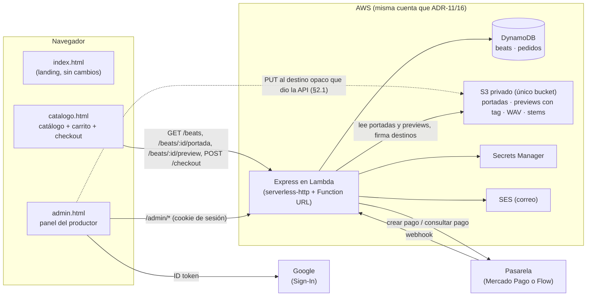

**Regla de capas en el backend** (mismo principio que "el componente nunca orquesta"): un handler de
Express solo traduce HTTP ↔ dominio. Reserva, cálculo del total, transición de estados y
procesamiento del webhook viven en módulos de dominio puros, testeados sin Express ni AWS.

### 2.1 Regla: la capa de datos está abstraída detrás de la API

**El frontend solo conoce el contrato de la API.** Ningún navegador (catálogo, panel, ni el enlace
de un correo) conoce hosts de S3, keys de objetos, nombres de tablas ni un SDK de AWS. Cambiar S3 por
otro storage, o DynamoDB por otra base, no toca una línea del frontend ni invalida un correo ya
enviado.

Lo que importa es **de quién depende el código, no por dónde viajan los bytes**. Toda URL que usa el
frontend es de la API, y la API decide cómo responder:

| Caso | El frontend pide | La API responde | Flujo |
|---|---|---|---|
| Portada, preview (archivos chicos) | `GET /beats/:id/portada` · `/preview` | Los bytes, leídos de S3 por Express | 4.1 |
| Entregable (cientos de MB) | `GET /descargas/:token/:archivo` | `302` a una URL firmada de S3 que vence en ~1 min | 4.11 |
| Subida desde el panel (cientos de MB) | `POST /admin/beats/:id/subidas` | Un **destino de subida opaco** (`url`, `method`, `headers`) que el panel usa tal cual | 4.8 |

Los archivos grandes no pueden atravesar Lambda: el request tiene un límite de 6 MB y la respuesta
de 6 a 20 MB. Para descarga y subida, la API autoriza y entrega un destino de vida corta, y los bytes
van directo entre el navegador y el storage. El frontend sigue sin saber qué hay detrás: sigue una
redirección o usa una URL que le dieron, sin construirla ni interpretarla.

**Consecuencias:**

- **Un solo bucket, 100% privado**, con prefijos `portadas/`, `previews/` y `entregables/`.
- Las respuestas de la API nunca exponen keys de S3, solo IDs de beat o pedido y tokens opacos.
- **En el backend, el mismo corte:** el dominio no importa el SDK de AWS. Depende de dos módulos,
  `beatsRepo`/`pedidosRepo` (datos) y `archivos` (almacenamiento: leer, destino de subida, destino de
  descarga), con un adaptador DynamoDB/S3 y uno en memoria para los tests. El de memoria es la
  segunda implementación real que exige la regla de honestidad de `engineering-guidelines.md` §2,
  así que el corte no es ceremonia.

**Si algún día se exige que ni un byte vaya directo al storage**, la única salida es sacar Express
de Lambda a un contenedor (App Runner, ECS o Lightsail), que no tiene esos límites. El contrato de la
API no cambiaría, así que el frontend tampoco.

## 3. Modelo de datos

### Tabla `beats`

| Campo | Tipo | Nota |
|---|---|---|
| `id` | string | PK |
| `titulo`, `bpm`, `tonalidad`, `genero` | string / number | Metadatos públicos |
| `precioClp` | number | Entero en pesos. **Lo carga el Productor** (ADR-6) |
| `estado` | `borrador \| disponible \| reservado \| vendido \| archivado` | Ver §3.1 |
| `reservadoHasta` | number (epoch ms) | Solo con `estado = reservado` |
| `pedidoId` | string | Pedido que lo reservó o compró |
| `portadaKey`, `previewKey` | string | Objetos del bucket privado; solo se sirven a través de la API (4.1). Nunca salen en una respuesta |
| `entregaKeys` | string[] | Objetos del bucket **privado** |
| `vendidoPor` | `sitio \| externo` | Externo = WhatsApp, Instagram, en persona |

### Tabla `pedidos`

| Campo | Tipo | Nota |
|---|---|---|
| `id` | string | PK; viaja a la pasarela como referencia externa |
| `beatIds` | string[] | |
| `totalClp` | number | Calculado en el servidor desde `beats.precioClp` |
| `comprador` | `{ nombre, email }` | Dato personal — Ley 21.719 |
| `estado` | `pendiente \| pagado \| rechazado \| expirado \| reembolso_requerido` | |
| `pagoId` | string | ID del pago en la pasarela; base de la idempotencia |
| `tokenDescarga`, `tokenVenceEn` | string / number | Token opaco de los enlaces del correo (4.11); reenviar lo reemplaza |
| `creadoEn`, `pagadoEn` | number | |

### 3.1 Estados de un beat

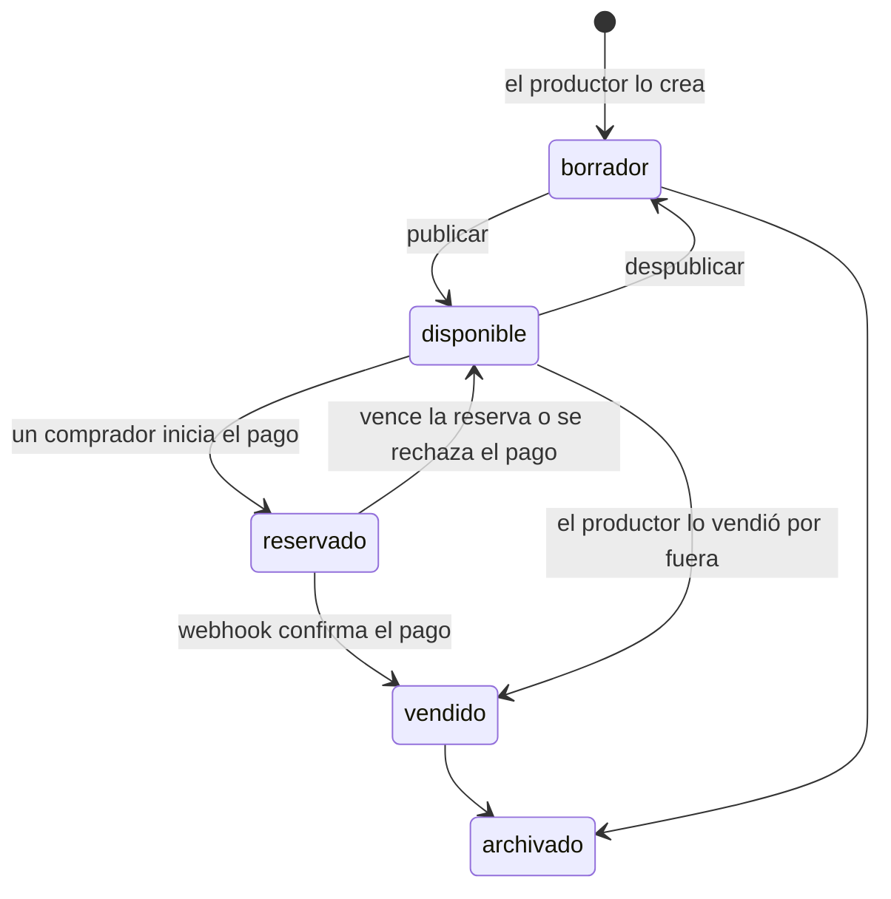

**La reserva vence sola, sin cron.** No hay un proceso que "libere" beats: un beat con
`estado = reservado` y `reservadoHasta < ahora` se trata como disponible. La escritura condicional
de la reserva acepta `estado = disponible OR (estado = reservado AND reservadoHasta < :ahora)`.
(El TTL nativo de DynamoDB borra ítems, no los actualiza, así que no sirve para esto.)

## 4. Diagramas de secuencia

Participantes comunes: **C** comprador (navegador) · **F** frontend del catálogo · **API** Express
en Lambda · **DB** DynamoDB · **S3** · **PSP** pasarela de pago · **SES** correo · **P** productor
(navegador) · **AF** frontend del panel · **G** Google.

### 4.1 Explorar el catálogo y escuchar una preview

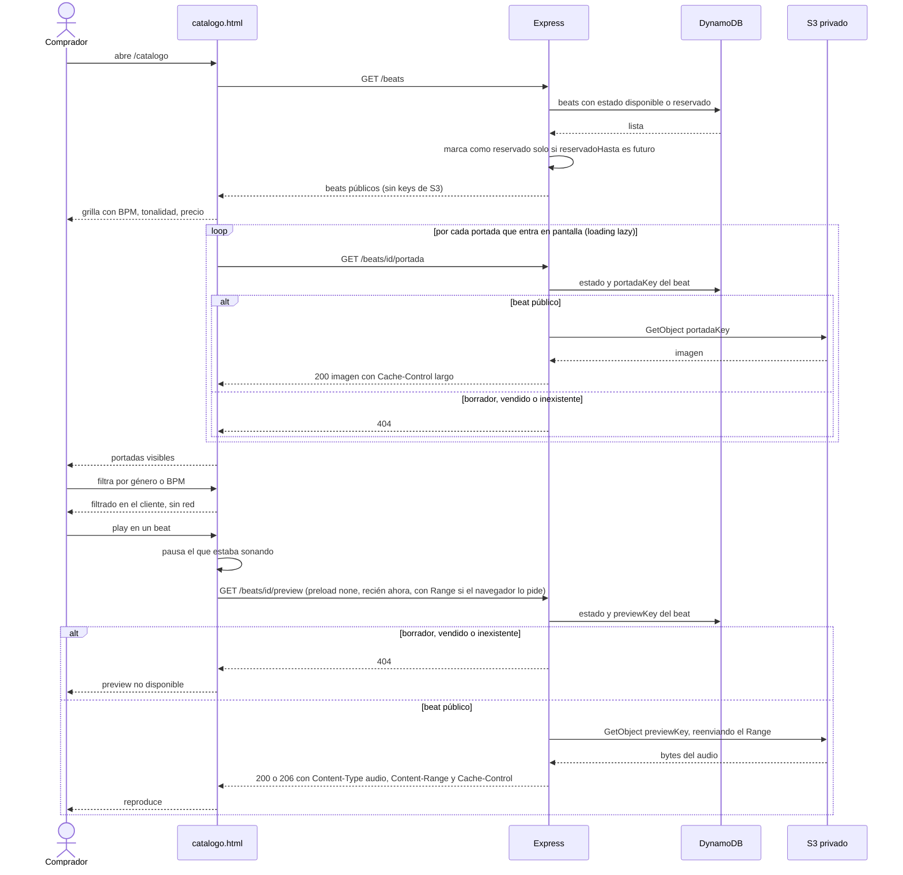

**Por qué portadas y previews pasan por Express:** regla §2.1. La API decide qué se puede ver y
escuchar: un beat vendido o en borrador deja de mostrarse y de sonar en el mismo momento en que
cambia su estado, y nadie puede listar el bucket ni enlazar archivos directo desde S3.

**Restricciones que esto impone:**

- **Tamaño de la respuesta de Lambda:** 6 MB con respuesta normal y hasta 20 MB con *response
  streaming*. Una preview con tag en MP3 de 128 kbps pesa ~1 MB por minuto, y una portada debe pesar
  bastante menos, así que se fija un tamaño máximo para ambas y se valida al publicar (RF-ADM-004).
- **`Range`:** el navegador lo usa para adelantar la reproducción. Express tiene que reenviarlo a
  S3 y responder `206` con `Content-Range`; si no, el reproductor no permite adelantar.
- **Binario a través de la Function URL:** `serverless-http` tiene que configurarse para responder
  binario (`audio/mpeg`) sin corromperlo.
- **Costo y latencia:** cada portada y cada play es una invocación de Lambda más una lectura de
  DynamoDB. `Cache-Control` evita que el navegador vuelva a pedir lo que ya tiene. Si el volumen lo
  pide, un CloudFront delante de la **API** (no del bucket) puede cachear las portadas sin romper la
  regla §2.1.

### 4.2 Carrito: agregar y validar antes de pagar

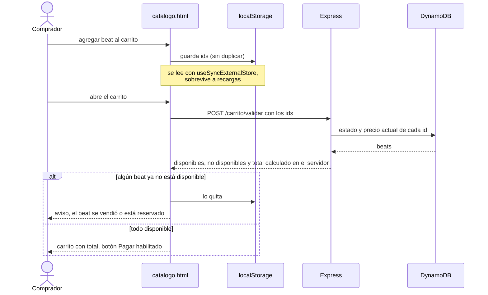

### 4.3 Checkout: reserva atómica y creación del pago

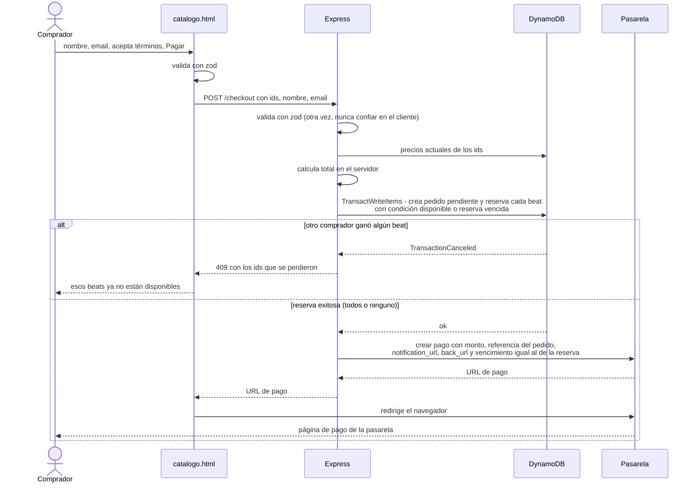

### 4.4 Confirmación por webhook y entrega (pago aprobado)

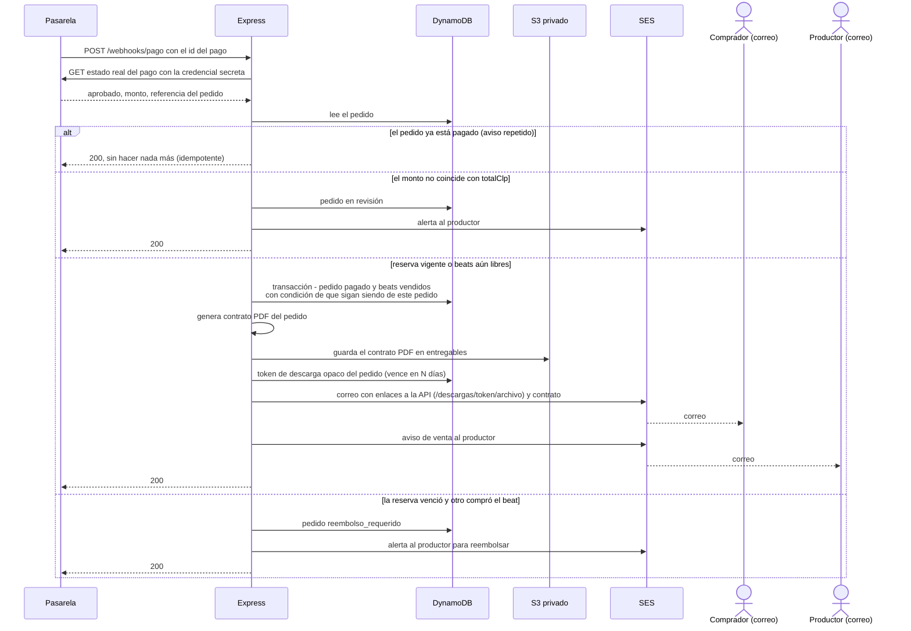

El último caso es raro (el vencimiento del pago en la pasarela se fija igual al de la reserva), pero
posible si la pasarela confirma tarde. Se resuelve con un reembolso manual, nunca vendiendo el beat
dos veces.

### 4.5 Vuelta del comprador a `/gracias`

Corre **en paralelo** al 4.4 y sin orden garantizado entre ambos.

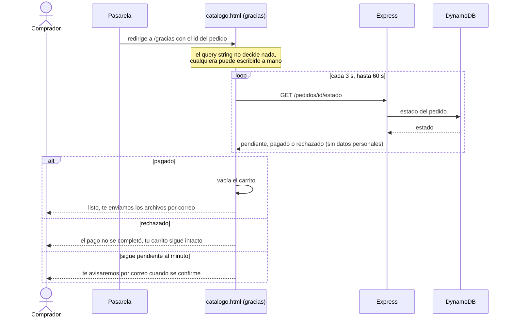

### 4.6 Pago rechazado o abandonado

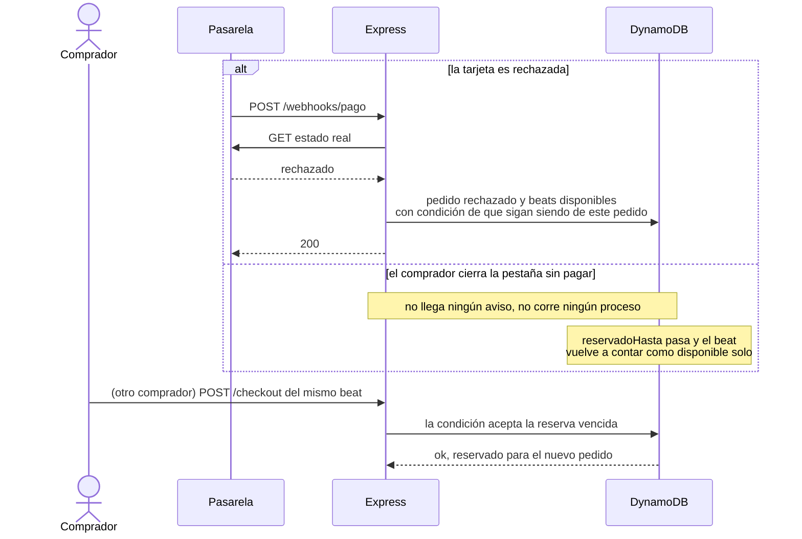

### 4.7 Inicio de sesión del productor con Google

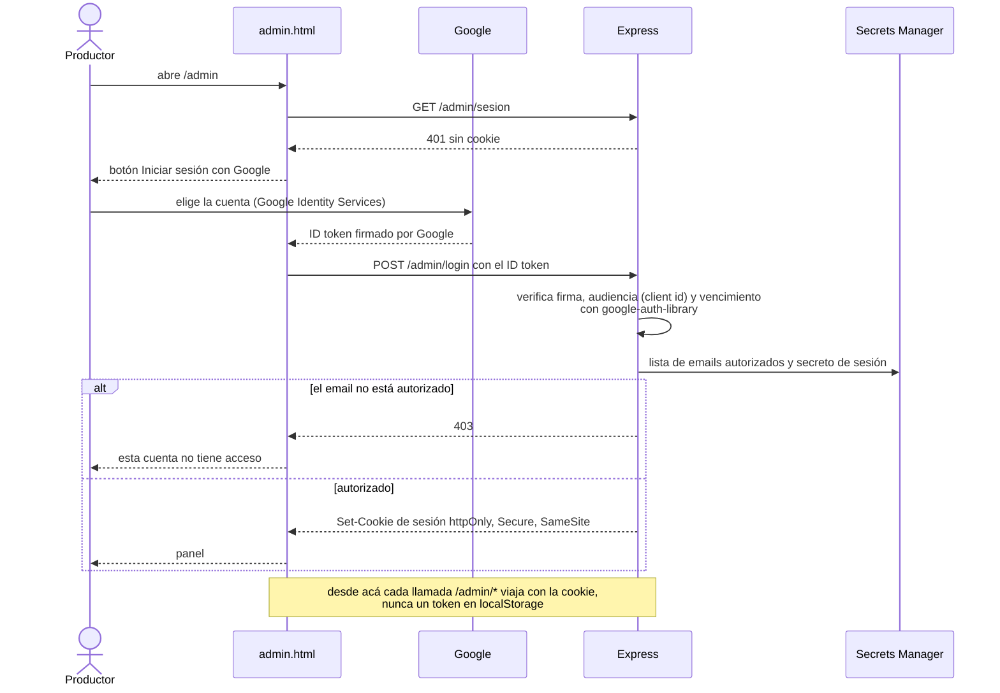

### 4.8 Alta de un beat

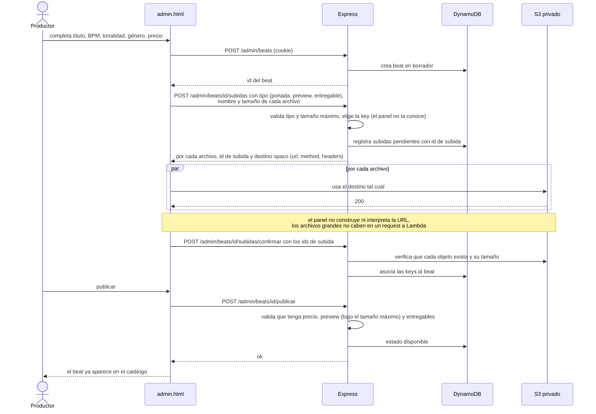

### 4.9 Venta por fuera del sitio

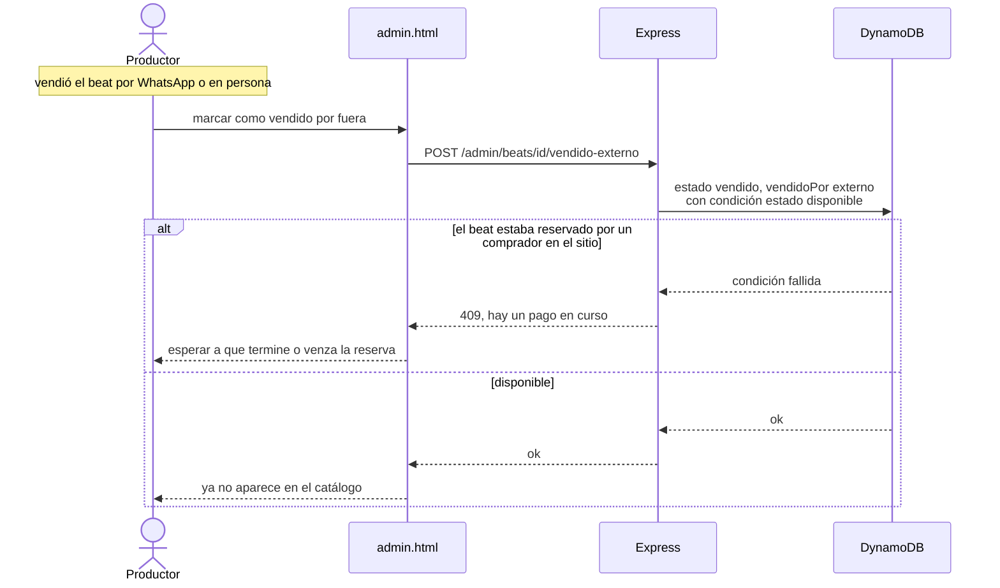

**Regla de operación:** si el Productor negocia un beat por otro canal, lo marca como vendido
**antes** de cerrar el trato. El sitio es la única fuente de verdad del inventario.

### 4.10 Reenviar la descarga de un pedido

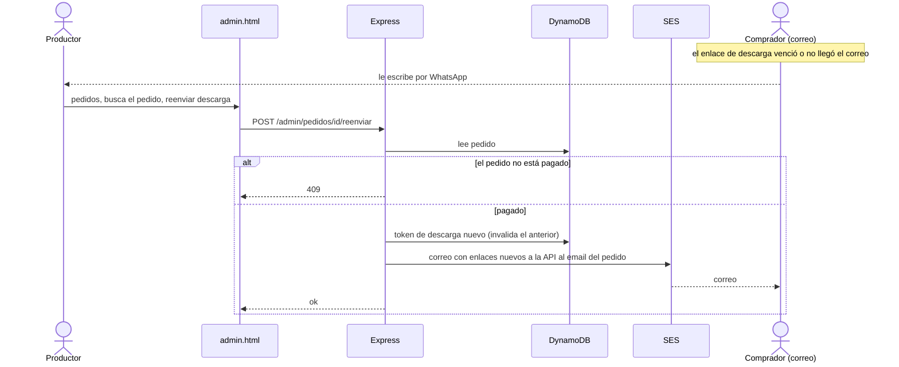

### 4.11 Descarga de un entregable

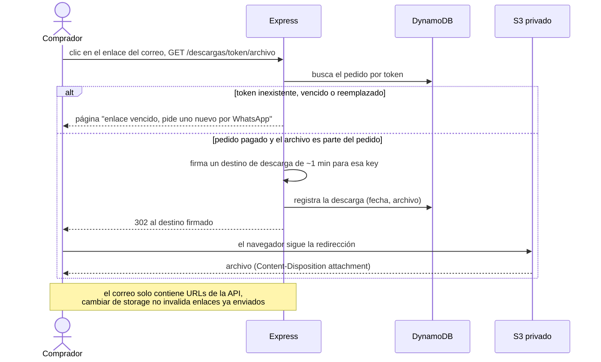

## 5. Decisiones abiertas (del Productor)

| Decisión | Afecta |
|---|---|
| Mercado Pago o Flow | 4.3, 4.4, 4.6 |
| Los beats vendidos se ocultan o se muestran como "Vendido" | 4.1, RF-CAT-005 |
| Qué se entrega (WAV, stems, proyecto) y la plantilla del contrato | 4.4, 4.8, RF-ENT-003 |
| Precios reales y beats disponibles para el lanzamiento | RNF-INT-004 |
| Duración de la reserva (propuesta: 15 min) | 4.3, 4.6 |
| Cómo se emite la boleta (manual o integrada) | RNF-LEG-002 |
| Canal del aviso de venta al Productor (correo o WhatsApp) | 4.4, RF-ENT-004 |
